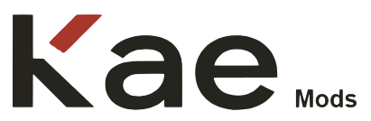

<p align="center"></p>

[](https://github.com/TheGudwinn/kae-mods/releases)
[](https://github.com/TheGudwinn/kae-mods/issues)
[](LICENSE)
[](https://tauri.app)

A mod manager for the Valve game Deadlock, built with Tauri, Rust, React and TypeScript.
Installs mods from GameBanana, manages their load order and updates, and works through proxies and mirrors on unreliable networks.

[Download](https://github.com/TheGudwinn/kae-mods/releases) | [Report a bug](https://github.com/TheGudwinn/kae-mods/issues) | [Request a feature](https://github.com/TheGudwinn/kae-mods/issues)

Table of Contents
-----------------

1. [Features](#features)
2. [Installation](#installation)
3. [Usage](#usage)
4. [Game integration](#game-integration)
5. [Development](#development)
6. [Known gaps](#known-gaps)
7. [License](#license)
8. [Contact](#contact)

Features
--------

- **Catalog**: GameBanana search, categories and sorting. The catalog is cached locally and opens without a connection.
- **Installation**: `.zip`, `.7z`, `.rar` and `.vpk` archives, validated before extraction (zip-slip protection, executables rejected, size limits).
- **Download queue**: sequential, pausable and resumable, persisted across restarts.
- **Library**: enable, disable and remove mods, set the load order (`pakNN` slots), undo the last action.
- **Updates**: in-app, single or bulk, including mods installed by other managers.
- **Camera check**: verifies hero cameras in installed models, including zstd-compressed resources, and marks fixed mods.
- **History**: installs and updates are listed on the Downloads page and kept between runs.
- **Profiles**: mod sets with JSON export and import, plus a one-line share code (`kae1:...`) to paste into a chat.
- **After a game patch**: mods installed on an older game build are listed with a risk level (hero models, effects and scripts break most often). Check for updates or switch the risky ones off in one click.
- **Find the broken mod**: switches half of the mods off, you start the game and answer whether the problem is still there; a few steps find the cause. Everything can be put back as it was.
- **Look inside before installing**: the mod page can show what a file changes (models, textures, sounds, heroes) without installing it.
- **Network**: HTTP, HTTPS and SOCKS5 proxies, a mirror list and step-by-step diagnostics (DNS, TCP, TLS).
- **Self-update**: signed application updates.
- **Privacy**: no accounts, no telemetry and no backend of our own; everything stays on your computer. Mods are never executed; only resources are extracted from archives.

Network requests
----------------

The only hosts the app talks to: `gamebanana.com` and `images.gamebanana.com` (catalog and downloads), `api.deadlock-api.com`
(hero portraits), `github.com` (update check, can be turned off in Settings) and `raw.githubusercontent.com` (news and community collections from the `content/` folder of this repository; the last copy is kept for offline use). The library lives in a local database on your machine.

Installation
------------

Windows 10 or 11 is required. Download the installer from the [Releases](https://github.com/TheGudwinn/kae-mods/releases) page and run it.
The installer bundles WebView2 and does not need an internet connection.

Usage
-----

1. Start Kae Mods. It locates the Deadlock installation through Steam; the path can be set manually in Settings.
2. Open the catalog, pick a mod and press Install. Progress is shown in the left panel and on the Downloads page.
3. Manage installed mods in the Library: toggle, reorder, update or remove them.

Game integration
----------------

- The game mounts only `pakNN_dir.vpk` files from `addons`. Kae Mods names its files accordingly and identifies its own files through its database.
- `gameinfo.gi` is modified minimally and backed up first. If missing, the `Mod citadel` and `Write citadel` entries are added.
- All changes are journaled and can be undone.

Development
-----------

Requirements: Node 24, pnpm, Rust (stable) and, on Windows, Visual Studio Build Tools with the C++ workload.

```bash
git clone https://github.com/TheGudwinn/kae-mods.git
cd kae-mods
pnpm install
pnpm tauri dev       # application with hot reload
pnpm build           # type check and build the interface
cargo test --manifest-path src-tauri/Cargo.toml
```

Tests use local mock servers and an embedded PostgreSQL. Tests marked `#[ignore]` access the real GameBanana and are run
separately: `cargo test --test live_mods_flow -- --ignored --nocapture`.

Running `pnpm dev` in a regular browser (without Tauri) serves the interface with sample data for layout work.

Known gaps
----------

- Which slot wins when files overlap has not been verified in the game (assumed: the lower number).

License
-------

Distributed under the GNU General Public License v3.0. See [LICENSE](LICENSE).

This project is not affiliated with Valve Corporation. Deadlock is a trademark of Valve Corporation.

Contact
-------

- Repository: https://github.com/TheGudwinn/kae-mods
- Issues: https://github.com/TheGudwinn/kae-mods/issues
